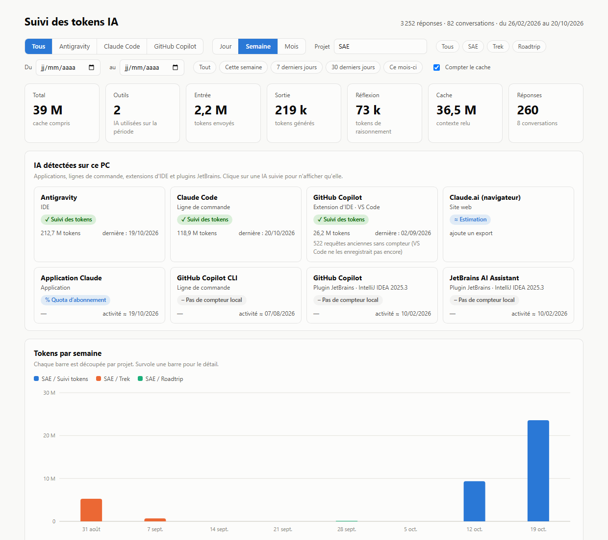

# 📊 Tok&Track

**Combien de tokens consommes-tu avec tes IA ?**
Tok&Track trouve les IA installées sur ton PC et affiche ta consommation par jour, semaine, mois et projet.



Tout est calculé sur ton PC. Aucune IA n'est appelée : le suivi ne coûte aucun token.

---

## 🚀 Installer

### [⬇️ Télécharger Tok&Track pour Windows](https://github.com/RoadsPlanner/TokenTrack/releases/latest/download/Installer-TokTrack.exe)

1. Lance le fichier téléchargé et clique sur **Suivant** jusqu'au bout.
2. Ouvre **Tok&Track** depuis le menu Démarrer ou le Bureau.

C'est tout. Pas besoin de télécharger le projet, ni d'installer Node.js, ni d'avoir les droits administrateur.

> Si Windows affiche « Windows a protégé votre ordinateur » : **Informations complémentaires** › **Exécuter quand même**.

---

## 🔄 Mises à jour

### Pour les utilisateurs : rien à faire

On installe l'appli une seule fois. Ensuite, à chaque ouverture, Tok&Track vérifie s'il existe une nouvelle version. Si oui, il l'installe tout seul et se rouvre : l'ouverture prend juste une dizaine de secondes de plus cette fois-là.

### Pour publier une nouvelle version

1. Modifie le code dans `code/`.
2. Double-clique sur **`installateur/publier.cmd`** et attends le message « Version … publiée ».
3. Commite et pousse tes changements (dont `code/version.json`).

`publier.cmd` augmente le numéro de version, crée l'installeur et le met en ligne dans les **Releases** du dépôt. C'est cette étape qui met à jour les utilisateurs. Le push garde simplement le code à jour sur GitHub.

> **La première fois seulement**, connecte GitHub dans un terminal avec `gh auth login`. Il faut avoir le droit de publier sur `RoadsPlanner/TokenTrack`.
>
> 🔒 Tous les PC installent ce qui est publié : ne donne ce droit qu'à des personnes de confiance.

---

## 👀 Utiliser

Le tableau de bord s'ouvre dans sa propre fenêtre. Ferme-la et rouvre Tok&Track pour actualiser les chiffres.

- **Fiches IA** : clique sur une IA pour ne voir qu'elle.
- **Vue et période** : au-dessus du graphique (heure, jour, semaine, mois).
- **Compter le cache** : décoche pour retirer le contexte relu.
- **Télécharger en CSV** : sous le tableau détaillé.

| Mot | Signification |
|---|---|
| **Token** | petit morceau de texte (3 à 4 caractères), l'unité des IA |
| **Entrée** | ce qui est envoyé à l'IA |
| **Sortie** | ce que l'IA écrit |
| **Réflexion** | le raisonnement de l'IA avant de répondre |
| **Cache** | le contexte relu à chaque réponse : lourd, mais peu cher |
| **≈** | estimé, pas mesuré |

> ⚠️ Claude Code efface ses conversations après 30 jours : **ouvre Tok&Track au moins une fois par mois**.

---

## 🔍 IA suivies

| IA | Suivi |
|---|---|
| Claude Code, Antigravity, Cline, Roo Code, Kilo Code | ✓ tokens réels |
| GitHub Copilot (VS Code) | ✓ réels, ≈ pour les anciennes requêtes |
| Gemini CLI, OpenAI Codex (Windows et WSL) | ✓ tokens réels |
| Claude en chat (claude.ai) | ≈ estimé depuis ton export |
| Application Claude | % du quota d'abonnement |
| Cursor, Windsurf, ChatGPT, Ollama… | détectées, sans compteur |

---

## 💬 Ajouter tes conversations claude.ai

1. Sur claude.ai : **Paramètres › Confidentialité › Exporter les données**.
2. Ouvre le fichier `manifest-….json` reçu avec le Bloc-notes, cherche `"category": "conversations"` et copie le lien `export_url` juste au-dessus.
3. Colle ce lien dans ton navigateur : **`conversations-000.zip`** se télécharge.
4. Dépose le zip dans **`exports-claude-ai`** (menu Démarrer › *Dossier des données Tok&Track*), puis rouvre Tok&Track.

Le lien expire en 24 h maximum. Refais un export chaque mois : rien n'est compté deux fois.

<details>
<summary>Comment les tokens sont estimés</summary>

L'export contient le texte des conversations mais aucun compteur. Tok&Track compte environ 3,5 caractères par token, ~1 600 tokens par image, et reconstitue l'entrée, la sortie, le cache et la réflexion de chaque réponse. Certaines choses ne sont pas dans l'export (instructions internes, contenu des PDF) : le vrai total est sans doute un peu plus élevé.
</details>

---

## ⚙️ Données et réglages

Tout est dans **`%LOCALAPPDATA%\Tok&Track`** (menu Démarrer › *Dossier des données Tok&Track*). Ces fichiers restent si tu désinstalles.

| Fichier | Rôle |
|---|---|
| `config.json` | tes réglages |
| `historique-tokens.json` | tout ce qui a été compté. **Ne le supprime pas.** |
| `exports-claude-ai/` | tes exports claude.ai |

<details>
<summary>Réglages de config.json</summary>

| Clé | Rôle |
|---|---|
| `sousProjets` | ranger les conversations par projet |
| `membre`, `debutSemaine1` | ton prénom et la semaine n°1 (tableau d'équipe) |
| `dossiersConversations`, `dossiersClaude` | où chercher les conversations (`~` = ton dossier utilisateur) |
| `caracteresParToken` | ratio des estimations (3,5) |
| `wsl` | `false` pour ignorer WSL |

```json
{ "nom": "SAE / Roadtrip", "dossiers": ["BUT3/SAE", "claude.ai"], "motsCles": ["road.?trip"] }
```
Les conversations de ces dossiers qui contiennent ces mots-clés sont rangées dans ce projet.
</details>

---

## 🛠️ Développement

```
Tok&Track/
├── code/           le programme (JavaScript)
├── installateur/
│   ├── publier.cmd     publie une mise à jour pour tous les PC
│   └── construire.cmd  crée l'installeur sans le publier (pour tester)
└── docs/           image du README
```

Outils nécessaires : [Node.js](https://nodejs.org) 22.5+, [Inno Setup 6](https://jrsoftware.org/isinfo.php), [GitHub CLI](https://cli.github.com).

Lancer sans installer :

```bash
node code/suivi_tokens.js
```

Autres vues en ligne de commande : `node code/suivi_tokens.js --aide`.
